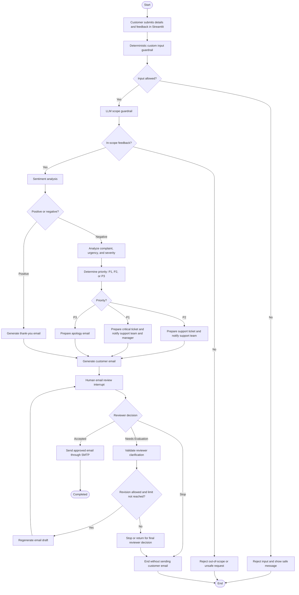

# Customer Feedback Support Agent

An AI-powered customer support workflow built with **Python, Streamlit, LangGraph, LangChain, and LLMs**.

The application accepts customer feedback, validates that the input is in scope, analyzes sentiment, evaluates negative feedback for urgency and severity, and prepares an email response. For higher-priority complaints, it also prepares a support ticket and notifies the appropriate internal recipients. Before an email is sent to a customer, a human reviewer can approve it, request a revision, or stop the workflow.

The goal is to combine useful LLM automation with **deterministic guardrails, explicit human approval, and controlled workflow execution**.

---

## Table of contents

- [At a glance](#at-a-glance)
- [What problem does this project solve](#what-problem-does-this-project-solve)
- [How the application works](#how-the-application-works)
- [Final workflow graph](#final-workflow-graph)
- [Priority and escalation rules](#priority-and-escalation-rules)
- [Guardrails and safety](#guardrails-and-safety)
- [Human review and approval](#human-review-and-approval)
- [Technology stack](#technology-stack)
- [Project structure](#project-structure)
- [Quick start](#quick-start)
- [Environment configuration](#environment-configuration)
- [Run the application](#run-the-application)
- [Run tests](#run-tests)
- [State, checkpointing, and limitations](#state-checkpointing-and-limitations)
- [Screenshots and visual documentation](#screenshots-and-visual-documentation)
- [Possible future enhancements](#possible-future-enhancements)
- [License](#license)

---

## At a glance

| Area | What the application does |
|---|---|
| User interface | Collects customer name, email, and feedback in Streamlit |
| Input validation | Checks feedback with a deterministic Python guardrail |
| Scope validation | Uses a separate LLM-based guardrail with structured output |
| Sentiment | Classifies feedback as positive or negative |
| Complaint analysis | Evaluates negative feedback, including issue details, urgency, and severity |
| Prioritization | Assigns P1, P2, or P3 handling |
| Ticket handling | Prepares a support ticket for P1/P2 cases |
| Email drafting | Generates a customer-facing email |
| Human oversight | Allows a reviewer to accept, request evaluation/revision, or stop |
| Delivery | Sends the accepted email using SMTP |
| Workflow state | Uses LangGraph checkpoints in memory during the session |

## What problem does this project solve?

Customer feedback can arrive in large volumes and may contain anything from a simple compliment to an urgent service complaint. Manually reviewing every message, deciding which issue needs attention, drafting a response, and notifying the right people can be time-consuming.

This project demonstrates how an AI-assisted workflow can help:

1. **Understand feedback:** identify whether a message is positive or negative.
2. **Recognize important complaints:** extract the issue and assess urgency and severity.
3. **Prioritize work:** distinguish lower-priority feedback from issues that need support or management attention.
4. **Prepare consistent communication:** draft a relevant response for the customer.
5. **Keep a human in control:** require a reviewer to approve the email before delivery.

The application assists the support process; it does not replace the human reviewer.

## How the application works

### 1. Customer submits feedback

A user enters the customer's details and feedback through the Streamlit interface:

- Customer name
- Customer email address
- Feedback message

### 2. Input guardrails validate the message

Before the main feedback workflow runs, the application checks whether the submitted text is appropriate for this customer-feedback use case.

- A deterministic custom Python guardrail runs first.
- An LLM-based scope guardrail runs next.
- If a guardrail rejects the input, the main feedback workflow does not proceed.

### 3. Sentiment is classified

The workflow determines whether the feedback is positive or negative.

- **Positive feedback:** the application prepares a thank-you email.
- **Negative feedback:** the application proceeds to complaint analysis and prioritization.

### 4. Negative feedback is analyzed

The complaint analysis evaluates details such as the issue category, urgency, and severity. The workflow uses these results to determine the appropriate priority and escalation path.

### 5. The response is drafted

The application generates a customer-facing email. Depending on the priority, it may also prepare a support ticket and internal notifications.

### 6. A human reviews the email

The workflow pauses for a reviewer to choose an outcome:

- Accept the draft.
- Request further evaluation/revision with clarification.
- Stop the workflow.

### 7. The approved email is sent

Only an accepted draft proceeds to SMTP email delivery. A stopped workflow does not send the customer email.

---

## Final workflow graph

The following Mermaid diagram is the high-level workflow represented by the current application. GitHub renders Mermaid diagrams directly in Markdown.



### Graph walkthrough

| Graph stage | Purpose |
|---|---|
| Streamlit submission | Collects the customer's details and feedback |
| Custom guardrail | Performs deterministic checks before LLM processing |
| LLM scope guardrail | Checks whether the request belongs to the supported feedback use case |
| Sentiment analysis | Routes positive and negative feedback differently |
| Complaint analysis | Evaluates issue details, urgency, and severity for negative feedback |
| Priority routing | Selects the P1, P2, or P3 handling path |
| Email generation | Creates the customer-facing draft |
| Human review interrupt | Pauses the graph until a reviewer responds |
| Clarification validation | Checks reviewer feedback before a revision is generated |
| SMTP delivery | Sends the accepted customer email |

> **Implementation note:** This is a documentation-level view of the workflow. The exact node names, edge names, and conditional routing should be kept in sync with the graph implementation in `src/app/agents/` and the pipeline entry points in `src/app/pipelines/`.

## Priority and escalation rules

The current workflow uses three priority levels for negative feedback.

| Priority | Typical handling | Internal action | Customer response |
|---|---|---|---|
| **P3** | Lower urgency | No support-ticket escalation in the described flow | Apology-focused response |
| **P2** | Requires support attention | Prepare support ticket and notify support team | Relevant response draft |
| **P1** | Critical issue requiring escalation | Prepare critical ticket and notify support team and manager | Relevant response draft |

The exact priority decision is made by the complaint-analysis logic. Priority should be based on the application's configured rules and analysis output, not on the sentiment label alone.

## Guardrails and safety

The application uses more than one validation layer so that untrusted text is checked before it reaches the main LLM workflow.

### 1. Deterministic custom input guardrail

The custom Python guardrail runs before LLM processing of customer feedback.

It is checked:
- In the Streamlit form, so the user can receive immediate feedback.
- Again in the pipeline, as a safeguard for callers that do not use the Streamlit interface.

Example:

```python
from app.guardrail import custom_guardrail

result = custom_guardrail(feedback)

if not result.allowed:
    raise ValueError(result.reason)
```

This layer provides predictable, code-controlled checks. Keyword matching is a preliminary signal; it is not a complete security solution and does not prove that an input is safe.

### 2. LLM-based scope guardrail

A second validator runs after the deterministic check and before the customer-feedback workflow.

It uses:
- A separate system prompt.
- Structured Pydantic output.
- A fail-closed policy for rejected or uncertain input.

It is intended to reject unrelated requests, prompt-injection attempts, and ambiguous requests before the main workflow starts.

Example:

```python
from app.guardrail import llm_guardrail

result = llm_guardrail(feedback)

if not result.allowed:
    raise ValueError(result.safe_response or result.reason)
```

### 3. Reviewer clarification validation

Human review comments are also checked before the graph resumes and before a revision reaches the email-generation LLM.

Review-specific wording checks allow normal feedback about tone, phrasing, or content. The reviewer decision and score are structured controls rather than free-text instructions to the LLM.

### Guardrail boundary

The current application does not provide inbound free-text forms for support-team or manager responses; those roles receive generated notifications. If such input is added later, apply suitable validation before passing it into the workflow.

## Human review and approval

The email review step is a Human-in-the-Loop (HITL) checkpoint. LangGraph pauses execution while a person reviews the generated draft.

| Reviewer choice | Workflow behavior |
|---|---|
| `Accepted` | Continues to SMTP delivery |
| `Needs Evaluation` | Validates clarification and may regenerate the draft |
| `Stop` | Ends the workflow without sending the customer email |

A configurable `MAX_EMAIL_REVISIONS` setting limits the revision loop and helps prevent endless regeneration.

The review step is important because generated text can be inaccurate, incomplete, or unsuitable for a particular customer situation. Human approval is the final control before customer email delivery.

## Technology stack

| Technology | Role in this project |
|---|---|
| Python 3.13+ | Main application language |
| Streamlit | User interface for submitting feedback and reviewing workflow output |
| LangGraph | Stateful workflow orchestration, branching, interrupts, and checkpointing |
| LangChain | LLM integration and model invocation |
| Google Gemini | Configured LLM provider used for negative-feedback analysis |
| Groq | Configured LLM provider used for sentiment and email generation |
| Pydantic | Structured data models and validation |
| pydantic-settings | Environment-based application configuration |
| SMTP | Outbound customer and internal email delivery |
| `uv` | Dependency and environment management |

Provider usage can be controlled through the application's environment configuration.

## Project structure

```text
.
├── main.py                         # Streamlit application entry point
├── README.md                       # Project documentation
├── .env.example                    # Example environment configuration
├── requirements.txt                # Dependency list
├── pyproject.toml                  # Project metadata and dependency definitions
├── src/
│   └── app/
│       ├── agents/                 # LangGraph workflow and agent logic
│       ├── configs/                # Settings and environment validation
│       ├── constants/              # App defaults and company details
│       ├── guardrail/              # Deterministic and LLM-based input checks
│       ├── helpers/                # LLM factory and helper functions
│       ├── pipelines/              # Workflow entry points
│       ├── schemas/                # Pydantic state and output models
│       └── tools/                   # Placeholder/extension area for tools
├── tests/
│   └── test_priority_escalation.py # Priority and escalation tests
└── uv.lock                         # Locked dependency versions
```

## Quick start

### Prerequisites

- Python 3.13 or later.
- `uv` installed.
- API credentials for at least one enabled LLM provider.
- An SMTP account or SMTP relay with permission to send email.

### 1. Clone the repository

```bash
git clone <YOUR_GITHUB_REPOSITORY_URL>
cd <YOUR_REPOSITORY_DIRECTORY>
```

Replace the placeholders with your actual GitHub repository URL and directory name.

### 2. Install dependencies

```bash
uv sync
```

### 3. Create your environment file

On Windows PowerShell:

```powershell
Copy-Item .env.example .env
```

On macOS or Linux:

```bash
cp .env.example .env
```

### 4. Configure credentials

Open `.env` and provide the values required by your setup. See [Environment configuration](#environment-configuration).

### 5. Start the Streamlit application

```bash
uv run streamlit run main.py
```

Streamlit will print a local URL in the terminal. Open that URL in your browser.

## Environment configuration

The application reads configuration from `.env` using `pydantic-settings`.

| Variable | Required | Purpose |
|---|---|---|
| `ENABLE_GEMINI` | Required for Gemini usage | Enables Google Gemini |
| `ENABLE_GROQ` | Required for Groq usage | Enables Groq |
| `GOOGLE_API_KEY` | If Gemini is enabled | Gemini API credential |
| `GROQ_API_KEY` | If Groq is enabled | Groq API credential |
| `SMTP_HOST` | Usually required | SMTP server host; default is `smtp.gmail.com` |
| `SMTP_PORT` | Usually required | SMTP server port; default is `587` |
| `SMTP_USER` | Yes for SMTP delivery | Sender email address |
| `SMTP_PASSWORD` | Yes for SMTP delivery | SMTP app password or provider authentication secret |
| `SUPPORT_EMAILS` | Yes for support notifications | JSON list of support recipient email addresses |
| `MANAGER_EMAILS` | Yes for manager escalation | JSON list of manager recipient email addresses |
| `MAX_EMAIL_REVISIONS` | No | Maximum email revision attempts; default is `3` |
| `LLM_MAX_RETRIES` | No | Maximum LLM request retries; default is `3` |
| `LLM_REQUEST_TIMEOUT_SECONDS` | No | LLM request timeout; default is `60` |

The application validates that at least one LLM provider is enabled and that configured email recipient lists contain valid addresses.

Example recipient-list format:

```dotenv
SUPPORT_EMAILS=["support@example.com","support-lead@example.com"]
MANAGER_EMAILS=["manager@example.com"]
```

Use real values only in your local `.env` file. Do not commit `.env`, API keys, SMTP passwords, or other secrets to Git.

## Run the application

```bash
uv run streamlit run main.py
```

Expected user journey:

1. Open the Streamlit application.
2. Enter customer name and email.
3. Enter the customer's feedback.
4. Submit the form.
5. Review the analysis and generated email.
6. Choose an approval action when prompted.
7. If accepted, the application sends the email through SMTP.

The exact screen layout depends on the current Streamlit implementation.

## Run tests

Run the unit tests with Python:

```bash
python -m unittest discover -s tests -v
```

Or use the project environment managed by `uv`:

```bash
uv run python -m unittest discover -s tests -v
```

The repository currently includes a priority-escalation test module. Add tests for guardrails, routing, revision limits, and email-delivery behavior as those areas evolve.

## State, checkpointing, and limitations

### LangGraph state and checkpoints

The workflow uses LangGraph state to carry customer details, analysis results, priority information, email content, and review decisions between nodes.

The current application uses LangGraph `InMemorySaver` for checkpointing. This supports pauses and resumes during the running application session, but **does not persist checkpoints across application restarts**.

For durable production workflows, consider a persistent LangGraph checkpointer supported by your deployment environment, and define retention, access-control, and recovery policies.

### Current project boundaries

- The application is designed for an internal customer-support workflow.
- It does not currently integrate with an external ticketing platform; ticket creation is handled within the application's current workflow logic.
- Support-team and manager roles receive generated notifications; the current application does not expose inbound free-text forms for those roles.
- Web search and OpenAI integrations may appear in settings or dependencies, but they are not actively wired into the current graph flow.
- Email delivery requires valid SMTP configuration and provider permission.
- In-memory checkpoints are lost when the application process restarts.

## Screenshots and visual documentation

Screenshots help visitors understand the application before cloning it. Add real screenshots from your running Streamlit application to `docs/images/`.

Suggested repository layout:

```text
docs/
└── images/
    ├── streamlit-feedback-form.png
    ├── feedback-analysis-result.png
    ├── priority-and-ticket-result.png
    └── human-email-review.png
```

Recommended screenshots:

1. **Feedback form:** show the customer input fields and feedback submission area.
2. **Analysis result:** show sentiment and complaint analysis output.
3. **Priority and escalation:** show a representative P1/P2/P3 result and related ticket/notification information, if displayed by the UI.
4. **Human review:** show the generated email and the reviewer actions.

After adding the actual screenshots, insert them into this README with Markdown:

```markdown


```

Only add screenshots that reflect the current application. Do not create placeholder screenshots that could be mistaken for real application output.

## Possible future enhancements

The following are ideas for future development, not claims about features already implemented:

- Persist LangGraph checkpoints in a production database.
- Integrate with an external ticketing system such as Jira or Zendesk.
- Add authentication and role-based access for reviewers.
- Add audit logs for approval decisions and email delivery.
- Add observability for graph execution, model latency, retries, and failures.
- Add automated tests for guardrail bypass attempts and prompt-injection cases.
- Add idempotent email-delivery handling to reduce duplicate sends.
- Add a dashboard for feedback volume, sentiment trends, and priority distribution.
- Add evaluation datasets to measure classification and response quality.

## License

This project is licensed under the MIT License. See [LICENSE](./LICENSE) for details.
